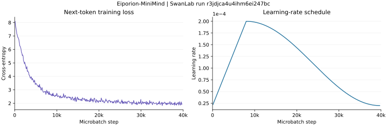

# Eiporion-MiniMind: Direct INT8 Weight Training for a Small Language Model

[中文报告](README_zh.md)

## Abstract

Eiporion-MiniMind investigates whether the projection weights of a small decoder-only language model can remain in INT8 storage while being updated during pretraining. The implementation combines a MiniMind-derived transformer with Eiporion, a companion PyTorch library developed for quantized linear layers and discrete weight updates. Attention and feed-forward projections use INT8 weight buffers and per-row floating-point scales; the shared token embedding/output head and normalization weights remain floating point.

The project includes an eight-layer model with approximately 63.9 million dense-equivalent weights, a publicly tracked two-epoch training run, and reported zero-shot results on six English and Chinese benchmarks. The tracked run completed 39,696 microbatch iterations, with logged training loss decreasing from 8.0936 at step 100 to 1.9683 at the final step. A storage audit of a retained export gives **75.30 MiB for weights and scales**, compared with **243.81 MiB for the same unique weights stored in FP32**, or approximately **3.24× less weight storage**. The benchmark scores are close to chance on several tasks, so the experiment supports a study of training behavior and representation cost rather than a claim of competitive language understanding or accuracy parity with floating-point training.

## 1. Research question and scope

Reducing the size of a final checkpoint and reducing the state maintained during training are different problems. Post-training quantization starts from an already trained model. Many quantization-aware training recipes simulate quantization while updating a floating-point master copy. This project instead asks:

> Can the attention and feed-forward weight matrices themselves be maintained as INT8 tensors and receive useful updates during language-model pretraining?

The main difficulty is update resolution. A small adaptive-optimizer update can be much smaller than one step on an integer grid; deterministic rounding can erase it. The implementation combines accumulated update residuals with stochastic rounding so that these small updates can eventually change the stored integer weights.

The work comprises three connected pieces:

- **Eiporion:** the author's [companion library](https://github.com/fumitoshi0524/eiporion) for INT8 linear layers, custom backward computation, and quantized optimizer state.
- **Model integration:** replacing the seven projection matrices in each MiniMind-derived transformer block while retaining a floating-point embedding/output interface.
- **Experimental documentation:** the saved training trajectory, six reported benchmark results, and explicit accounting of which tensors are compressed.

This report uses *direct INT8 weight training* for that implementation. It does not assert that every tensor or arithmetic operation is integer-valued, that stochastic rounding removes all gradient approximation, or that the approach establishes a new general training paradigm.

## 2. Model architecture

The model follows the decoder-only design used in [MiniMind](https://github.com/jingyaogong/minimind): grouped-query attention, rotary position embeddings, RMSNorm, and SwiGLU feed-forward blocks. QK normalization is applied before attention-score computation.

| Component | Configuration |
|---|---|
| Transformer blocks | 8 |
| Hidden dimension | 768 |
| Query / key-value heads | 8 / 4 |
| Head dimension | 96 |
| Feed-forward intermediate dimension | 2,432 |
| Vocabulary | 6,400 tokens |
| Dropout | 0 |
| Embedding and output head | Shared floating-point weight matrix |
| Quantized projections per block | Q, K, V, O, gate, up, down |
| Stored projection weights | INT8 buffers with FP32 row scales |
| Configured positional buffer | 32,768 positions |
| Pretraining sequence length | 512 tokens |


*Architecture overview. The storage and precision assignments are specified in the table and method below.*

The 32,768-position configuration is not an evaluated context length. The code includes optional YaRN scaling, but `inference_rope_scaling` is disabled by default and no long-context evaluation is reported here.

### Parameter counting

INT8 weights are registered as buffers, so `sum(p.numel() for p in model.parameters())` does not count the full model. Conversely, adding the INT8 weights to an already dense-equivalent total counts them twice. The shared embedding and output head must also be counted only once.

For the configuration above:

| Unique weight group | Scalar count |
|---|---:|
| INT8 attention and feed-forward weights | 58,982,400 |
| Shared embedding/output weight | 4,915,200 |
| Normalization weights | 14,592 |
| **Dense-equivalent model weights** | **63,912,192** |
| Additional row-scale values | 63,488 |

The scales are quantization metadata and are listed separately. This gives the approximately 64M model size used throughout this report.

These counts can also be derived without a checkpoint. With $h=768$, $k=384$ (four KV heads), $f=2432$, $L=8$, and $V=6400$, the projection count is $L(2h^2+2hk+3hf)$; the shared embedding count is $Vh$; normalization contributes $L(2h+2\times96)+h$ values. The number of row scales is $L(3h+2k+2f)$.

## 3. Quantized representation and optimization

### 3.1 INT8 linear layers

For an output-by-input integer matrix $Q$ and a scale vector $s$, the effective weight is

$$
W_{ij}=s_i Q_{ij},\qquad Q_{ij}\in\{-127,\ldots,127\}.
$$

With inputs represented as rows, the layer computes $Y=XW^\top$. The transformer projections use no bias. Initialization starts from a Kaiming-uniform floating-point matrix and uses symmetric per-row scaling:

$$
s_i=\frac{\max_j |W^{(0)}_{ij}|}{127},\qquad
Q_{ij}=\operatorname{clip}\!\left(\operatorname{round}(W^{(0)}_{ij}/s_i),-127,127\right),
$$

with a small positive floor for zero rows. After initialization, the persistent representation is the integer matrix and its row scales rather than a separate floating-point master matrix for each quantized projection. The scales are buffers, not parameters learned by ordinary autograd.

Storage precision is separate from compute precision. The earlier Eiporion implementation used BF16 matrix multiplication after dequantizing the weights. The current library also has a CUDA/bitsandbytes INT8 forward path; backward matrix products still use BF16. These implementation paths do not establish an end-to-end integer-only training or inference result.

### 3.2 Custom backward computation

The custom autograd function computes input gradients and a floating-point gradient with respect to the effective weight:

$$
G_X=G_Y W,\qquad G_W=G_Y^\top X.
$$

It accumulates the weight gradient in a module-specific cache. The optimizer consumes that cache to update the INT8 buffer, which PyTorch cannot treat as a conventional differentiable floating-point parameter.

This is a surrogate optimization procedure over a discrete representation. Moving the update outside ordinary parameter autograd does not make the integer quantizer differentiable or prove that the full gradient estimator is unbiased.

### 3.3 Adaptive updates, residuals, and rounding

`EiporionOptim` combines AdamW-style updates with blockwise quantized first moments, second moments, and update residuals. The INT8 path uses blocks of 256 values with per-block scales and nonlinear companding. The remaining floating-point parameters are handled by the underlying bitsandbytes optimizer.

For a fixed row scale, a simplified description is:

$$
u_t=-\eta_t\left(\frac{\hat m_t}{\sqrt{\hat v_t}+\epsilon}+\lambda W_t\right),\qquad
r_t\leftarrow r_{t-1}+u_t/s,
$$

$$
\Delta Q_t=\mathcal R(r_t),\qquad
Q_{t+1}=\operatorname{clip}(Q_t+\Delta Q_t,-127,127),\qquad
r_t\leftarrow r_t-\Delta Q_t.
$$

The division by $s$ is rowwise. This schematic omits finite-precision state quantization and version-specific scale updates; those affect the actual optimization trajectory.

For ordinary stochastic rounding, a scalar $z$ is rounded to $\lfloor z\rfloor$ or $\lceil z\rceil$ with probabilities determined by its fractional part, giving $\mathbb E[\mathcal R(z)\mid z]=z$ before clipping. This explains how sub-integer updates can influence integer weights.

**The default optimizer is not pure stochastic rounding.** `train_pretrain.py` imports `EiporionOptim`, whose implementation adds a momentum-dependent bias to the rounding probability (`sr_bias_scale=0.15`). The library separately exposes `EiporionOptimSR` for the unbiased rounding variant. The scalar unbiasedness identity therefore cannot be attributed to the default optimizer or to the entire training procedure. No SR-versus-biased-SR comparison is claimed for this experiment.

The library has changed since the original experiment: [the early implementation](https://github.com/fumitoshi0524/eiporion/tree/bff6aab67a061b4a006b6d5a1dc6908b7c41c438) used fixed row scales during integer updates, while [the inspected later revision](https://github.com/fumitoshi0524/eiporion/tree/1dde29cbd12ea2fe0b14896f4931484f787917a6) updates scales and exposes additional optimizer variants. The public run records **Eiporion 0.1.0**. Reproducing it requires that version's implementation, not an assumption that the latest library is identical.

## 4. Training setup

Pretraining uses the MiniMind `pretrain_t2t_mini.jsonl` dataset and next-token cross-entropy. The dataset loader reads a `text` field, tokenizes and truncates each example, adds beginning/end tokens, and pads to 512 tokens. Padding labels are masked with `-100`; the model shifts logits and labels for next-token prediction.

| Setting | Run record and source defaults |
|---|---|
| Epochs | 2 |
| Microbatch size | 64 sequences |
| Gradient accumulation | 4 microbatches |
| Nominal effective batch size | 256 sequences on one device |
| Sequence length | 512 |
| Learning-rate scale | $2\times10^{-4}$ |
| Warmup | 8,000 microbatch iterations |
| Schedule | Linear warmup from 10% of the LR scale, followed by cosine decay toward 10% |
| Weight decay | 0.1 |
| Autocast precision | BF16 |
| Initial seed | 42; data-order seed changes by epoch |
| Projection optimizer | `EiporionOptim` |

The run name records two epochs, batch size 64, and a learning-rate scale of 0.0002. Its saved hyperparameter `config` is null; accumulation, sequence length, seed, and the other defaults above are reconstructed from the [source at the recorded Git revision](https://github.com/fumitoshi0524/eiporion-minimind/blob/abad71f5ea0a08d926b21475ae4afa59f57bdb92/trainer/train_pretrain.py) and the recorded command `train_pretrain.py --use_swanlab`. The SDK's recorded Git revision identifies HEAD, not proof of a clean working tree.

The console records **1,270,238 dataset examples** and **19,848 microbatches per epoch**, consistent with a final partial batch at batch size 64. The two epochs total **39,696 microbatch iterations**. With the source's accumulation factor of four, this corresponds to **9,924 optimizer updates**. The learning-rate clock advances per microbatch, not per optimizer update. Neither of these step counts is a token count; the data hash and number of non-padding tokens remain unrecorded, so a 40M-token budget is not established.

The public trainer does not call global gradient clipping; this report therefore does not list clipping at 1.0 as an implemented setting.

| Recorded runtime information | Value |
|---|---|
| Run | [`r3jdjca4u4ihm6ei247bc`](https://swanlab.cn/@fumitoshi/Eiporion-Pretrain/runs/r3jdjca4u4ihm6ei247bc) |
| Status | Finished |
| GPU | 1 × NVIDIA GeForce RTX 4090 D, 24 GB capacity |
| Tracking interval, UTC | 2026-05-09 12:26:25 to 15:53:11 |
| Tracked elapsed time | 3 h 26 min 46 s |
| Python | 3.12.3 |
| PyTorch | 2.8.0+cu128 |
| Transformers | 5.7.0 |
| Eiporion | 0.1.0 |
| bitsandbytes / SwanLab | 0.45.5 / 0.7.16 |
| Recorded Git revision | `abad71f5ea0a08d926b21475ae4afa59f57bdb92` |

The tracked interval includes startup and logging/checkpoint overhead; it is not an isolated compute-time or throughput measurement. GPU capacity is not peak allocated training memory. A compact [run record](docs/swanlab-run.json) preserves the relevant metadata and console excerpts without unrelated host details.

## 5. Results

### 5.1 Training behavior



*Next-token training loss and learning rate from the public SwanLab run. All 398 recorded points per series are plotted without smoothing; the horizontal axis counts microbatch iterations. The [original dashboard image](img/train_loss.png) is retained for comparison.*

The [public run](https://swanlab.cn/@fumitoshi/Eiporion-Pretrain/runs/r3jdjca4u4ihm6ei247bc) contains 398 points for each of `train/loss` and `train/lr`. Its scalar history and 413 console lines agree on the completed two-epoch schedule. The trajectory is consistent with the saved dashboard image.

| Observed quantity | Value |
|---|---:|
| First logged loss, microbatch step 100 | 8.093639 |
| Final logged loss, microbatch step 39,696 | 1.968347 |
| Lowest logged loss, microbatch step 35,048 | 1.829639 |
| Peak logged learning rate, microbatch step 8,000 | 0.0002 |
| Final logged learning rate | 0.00002 |

The first recorded point is not the initialization loss, and the lowest sampled loss is not a validation metric. The reported loss is the loss of the logged microbatch, not a full-dataset epoch average. These data establish a decreasing training objective in this run, not generalization or multi-seed stability.

The [exported scalar history](docs/training-history.csv) makes these values directly inspectable. The console additionally reports 4.93M ordinary PyTorch parameters, 58.98M dense-equivalent INT8 weights, 56.49 MiB for the quantized matrices plus scales, and 63.91M dense-equivalent total weights, consistent with the architecture and storage accounting below. Neither the run metadata nor its console includes a checkpoint SHA-256 or the six benchmark outputs, so the connection to a particular evaluated checkpoint remains unverified.

### 5.2 Zero-shot benchmark results

The following values are retained from the project's experiment write-up and existing result summary. They are reported **zero-shot** evaluations using the language-model evaluation harness, not fresh evaluations performed for this README revision. Per-example outputs, exact evaluation revisions, and a checkpoint-to-score manifest have not been released alongside the table.

| Benchmark | Accuracy (%) | Normalized accuracy (%) |
|---|---:|---:|
| ARC-Easy | 28.45 | 28.32 |
| HellaSwag | 27.32 | 28.58 |
| PIQA | 52.23 | 50.82 |
| WinoGrande | 52.64 | - |
| C-Eval, 52 subjects | 23.25 | - |
| CMMLU, 67 subjects | 25.30 | - |

PIQA and WinoGrande are binary-choice tasks, so their scores are close to the 50% uniform-choice reference. HellaSwag, C-Eval, and CMMLU are close to a 25% four-choice reference. ARC-Easy should not be assigned one exact uniform-choice baseline without inspecting the answer-option counts in the evaluated split. These comparisons are descriptive; without uncertainty estimates they do not establish statistical significance.

The table indicates limited downstream capability at this scale and training recipe. It does **not** show that INT8 training preserves FP32/BF16 accuracy: that would require a model trained with the same data, token budget, architecture, and evaluation settings in floating point. No such matched baseline is reported here.

### 5.3 Weight-storage accounting

The memory comparison below counts the same unique model weights on both sides and uses **MiB ($2^{20}$ bytes)** throughout. Counts were checked against the tensor header of a retained local `model.safetensors` export; the [audit record](docs/storage-audit.json) includes its SHA-256 and byte totals. The checkpoint itself is not included in this repository, and its identity with the benchmark checkpoint has not been independently established.

| Stored component | Values | Bytes per value | Storage (MiB) |
|---|---:|---:|---:|
| INT8 projection weights | 58,982,400 | 1 | 56.2500 |
| FP32 row scales | 63,488 | 4 | 0.2422 |
| Shared FP32 embedding/output weight | 4,915,200 | 4 | 18.7500 |
| FP32 normalization weights | 14,592 | 4 | 0.0557 |
| **Weights and scales** | | | **75.2979** |
| Equivalent unique weights in FP32 | 63,912,192 | 4 | **243.8057** |

Thus,

$$
\frac{243.8057}{75.2979}\approx3.24,
$$

or approximately **69.1% fewer bytes** for weights and scales relative to the FP32 representation. Compressing only the projection matrices yields approximately 4× storage reduction for those matrices, but the floating-point embedding/output weight reduces the whole-model ratio.

The full safetensors file occupies 78,977,456 bytes, approximately 75.32 MiB. It additionally contains 448 bytes of runtime handles and 21,488 bytes of header/prefix metadata. These file-format details are separate from model capacity.

The earlier approximately 56.1 MB versus 245 MB comparison mixed an INT8-projection subtotal with a whole-model FP32 estimate. It should not be used as a 4.4× whole-model storage claim. None of these weight-storage figures measures optimizer state, gradients, activations, temporary dequantization buffers, peak GPU allocation, or inference throughput.

## 6. Discussion and limitations

The most direct observation is that the public run's training loss decreases while its console and source identify integer-buffer transformer projections. Its parameter counts agree with the architecture, and the separate export audit shows a concrete reduction in weight representation cost. Together, these make the project a small-scale implementation study of direct quantized updates.

Several questions remain open:

- **Accuracy cost:** a matched floating-point training run is needed to isolate the effect of the INT8 representation.
- **Optimizer choice:** pure SR, momentum-biased SR, and deterministic rounding need controlled comparisons. This report does not assign their differences to the saved benchmark scores.
- **Quantization granularity:** per-row scales are implemented, but no substantiated per-row-versus-per-tensor ablation is presented.
- **Training and inference efficiency:** weight bytes are measured; peak memory, wall-clock time, tokens per second, and hardware-dependent kernel benefits are not.
- **Generalization and scale:** a training curve and one aggregate benchmark table do not establish robustness across seeds, model sizes, longer contexts, or instruction-tuning regimes.

The next useful experiment is a controlled floating-point baseline and optimizer ablation with identical data and logged token counts. This would connect the implementation's storage advantage to an interpretable accuracy and training-cost trade-off.

## 7. Using the implementation

### Environment and data

Python 3.12 or newer is required. The project declares its dependencies in [pyproject.toml](pyproject.toml); CUDA/PyTorch compatibility must match the machine running the experiment.

```bash
git clone https://github.com/fumitoshi0524/eiporion-minimind.git
cd eiporion-minimind
uv sync
```

The original training run's environment is recorded in Section 4 and [the run metadata](docs/swanlab-run.json). A separate retained local environment has newer Eiporion `0.1.1`, Transformers `5.8.0`, and SwanLab `0.7.17`, plus PyTorch `2.6.0+cu124` and lm-eval `0.4.11`; it should not be substituted for the training environment when attributing results. `uv sync` without a released lockfile can resolve newer packages; archive the resolved environment and the Eiporion revision for any new experiment.

Obtain `pretrain_t2t_mini.jsonl` using the [MiniMind data instructions](https://github.com/jingyaogong/minimind), and place it in `dataset/`. The dataset and trained weights are not committed here. Record the dataset hash and the number of non-padding tokens when comparing runs.

### Train

```bash
uv run python trainer/train_pretrain.py \
  --data_path dataset/pretrain_t2t_mini.jsonl \
  --epochs 2 --batch_size 64 --accumulation_steps 4 \
  --hidden_size 768 --num_hidden_layers 8 --max_seq_length 512 \
  --learning_rate 2e-4 --warmup_steps 8000 --weight_decay 0.1 \
  --from_weight none --save_weight pretrain --use_swanlab
```

The trainer writes `out/pretrain_768.pth` and resume checkpoints under `checkpoints/`. Use `--from_resume 1` to continue the corresponding saved run. The reported benchmark table concerns pretraining; the separate SFT script is not evidence of instruction-tuning results in this report.

### Export and evaluate

```bash
uv run python scripts/export_hf.py \
  --weight pretrain --hidden-size 768 --num-hidden-layers 8 --save-dir out

uv run lm_eval --model hf \
  --model_args pretrained=./out,trust_remote_code=True,dtype=float32 \
  --tasks arc_easy,hellaswag,piqa,winogrande,ceval-valid,cmmlu \
  --num_fewshot 0 --batch_size 8 \
  --output_path results/ --log_samples
```

Export includes the model implementation and tokenizer files required for local Hugging Face loading. The explicit floating-point dtype preserves the documented FP32 embedding/head representation; it does not convert the INT8 buffers into floating-point master weights. The evaluation command is a recipe for a new run, not a guarantee of reproducing the historical table. Save the result JSON, task versions, prompt settings, environment, and checkpoint hash with that run.

For an inspection of storage without loading the model or requiring a GPU:

```bash
python scripts/inspect_safetensors.py out/model.safetensors
```

### Repository map

| Path | Purpose |
|---|---|
| [`model/model_eiporion.py`](model/model_eiporion.py) | Model, attention, feed-forward blocks, and generation |
| [`dataset/llm_dataset.py`](dataset/llm_dataset.py) | Tokenization, padding, and training labels |
| [`trainer/train_pretrain.py`](trainer/train_pretrain.py) | Pretraining loop and optimizer wiring |
| [`trainer/train_util.py`](trainer/train_util.py) | Schedule, checkpointing, and parameter logging |
| [`scripts/export_hf.py`](scripts/export_hf.py) | Hugging Face checkpoint export |
| [`scripts/inspect_safetensors.py`](scripts/inspect_safetensors.py) | Header-only tensor-storage accounting |
| [`docs/storage-audit.json`](docs/storage-audit.json) | Recorded byte counts and inspected export hash |
| [`docs/swanlab-run.json`](docs/swanlab-run.json) | Training-run environment, counters, and console evidence |
| [`docs/training-history.csv`](docs/training-history.csv) | All 398 logged loss/LR samples |

## 8. Related work and acknowledgements

The architecture and data pipeline build on [MiniMind](https://github.com/jingyaogong/minimind). Eiporion is the author's companion implementation, not an unrelated third-party method presented as a new contribution here. Stochastic rounding and blockwise optimizer-state quantization have substantial prior work:

- Gupta et al., [*Deep Learning with Limited Numerical Precision*](https://proceedings.mlr.press/v37/gupta15.html), ICML 2015, studies stochastic rounding for low-precision training.
- Dettmers et al., [*8-bit Optimizers via Block-wise Quantization*](https://arxiv.org/abs/2110.02861), ICLR 2022, develops low-precision optimizer statistics. Eiporion uses bitsandbytes for its floating-point parameters and its own state/update logic for INT8 buffers.
- [EleutherAI's Language Model Evaluation Harness](https://github.com/EleutherAI/lm-evaluation-harness) provides the benchmark evaluation interface. Its [CLI documentation](https://github.com/EleutherAI/lm-evaluation-harness/blob/main/docs/interface.md) describes result and sample logging.

This report documents the [model-code snapshot](https://github.com/fumitoshi0524/eiporion-minimind/tree/44f40e5e77786290ae1c962935aa282ac6b0e0b2), the [public training run](https://swanlab.cn/@fumitoshi/Eiporion-Pretrain/runs/r3jdjca4u4ihm6ei247bc) and its recorded source revision, the existing evaluation summary, and the retained export's storage metadata. It distinguishes those observations from theoretical properties, implementation changes, and experiments that have not yet been established.
